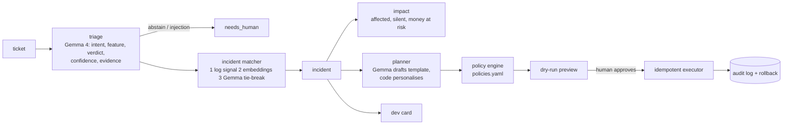

# TrustDesk

**An AI support agent you can actually trust.** It groups tickets into incidents, calculates the cost of a bug,
warns affected users who haven't written yet, and resolves everything with one audited bulk action.
Every decision comes with evidence, a policy check, an audit log and a measured accuracy score.

Built for PolyTech Code Fest x SKELAR (31.10.2026). Demo product: **Lumo**, a mocked online math school for kids.

## Why trust is the headline

Support teams don't delegate to agents because they can't verify them. TrustDesk's answer is a trust layer:

| layer | what it does | where |
|---|---|---|
| Evidence | triage cites the log events and doc lines it used; invented refs are dropped by code | `services/triage.py` |
| Confidence + abstain | below 0.6 (or a verdict with no proof) the ticket goes to a human | `services/triage.py` |
| Policy engine | the AI only *proposes*; YAML rules decide `auto / needs_approval / forbidden` | `policies.yaml`, `services/policy.py` |
| Dry-run | `POST /plan` shows who gets what, nothing is executed | `services/planner.py` |
| Idempotent execution | an idempotency key per action: running a plan twice changes nothing | `services/executor.py` |
| Audit + rollback | every action is logged; free lessons and reschedules can be rolled back | `services/executor.py` |
| Prompt-injection guard | user text is data inside `<user_message>`; injection phrases flag the ticket and block money actions | `llm/prompts.py`, `services/triage.py`, `policy.py` |
| Measured accuracy | labeled eval set, numbers below | `backend/eval/` |

## Architecture



Backend: Python 3.11+, FastAPI, SQLAlchemy + SQLite, Pydantic v2. Frontend: Next.js + TypeScript + Tailwind (`frontend/`).
The API contract is in `docs/PLAN.md` section 3.

### How Gemma 4 is used
Through the Gemini API (`google-genai`); model ids come only from env (`GEMMA_MODEL`, `EMBED_MODEL`).
Gemma has no JSON mode, so `llm/client.py` never relies on `response_mime_type`: it extracts and repairs JSON itself,
validates with Pydantic and retries once with the validation error appended. Quota errors (429) are waited out;
if the model stays unusable the ticket is marked `needs_human`. Gemma is used for triage, the incident tie-break
and the apology template; embeddings use the Gemini embedding model. `LLM_MODE=mock` swaps in deterministic keyword
fixtures so tests and the demo run with no network.

## Run it

```bash
cd backend
pip install -r requirements.txt
cp ../.env.example .env          # LLM_MODE=mock works with no key; for live set GEMINI_API_KEY and LLM_MODE=live
uvicorn app.main:app --reload    # http://localhost:8000/api/health (seeds the demo db on first start)
pytest                           # runs fully offline in mock mode
python -m eval.run_eval          # triage + grouping metrics on the labeled set -> eval/report.json
```

Demo flow via curl: `POST /api/demo/reset` -> `POST /api/demo/wave` -> `GET /api/incidents` -> `POST /api/incidents/inc_1/plan`
-> `POST /api/incidents/inc_1/execute` (twice: the second run executes 0) -> `GET /api/incidents/inc_1/devcard`.

## Tests
**69** tests, all green in mock mode (`cd backend && pytest`): policy table, idempotency, impact numbers,
matcher grouping and concurrency, injection can't trigger a refund, LLM failure -> `needs_human`, JSON repair, eval maths.

## Eval results
Live run on 31 labeled tickets (`backend/eval/tickets_labeled.json`: 14 incident tickets, 5 homework, payments, video,
general requests, 3 unclear, 3 prompt injections), model `gemma-4-26b-a4b-it`, raw numbers in `backend/eval/report.json`:

| metric | value |
|---|---|
| triage accuracy (feature + verdict; "should abstain" tickets count when handed to a human) | 0.903 |
| verdict macro-F1 | 0.952 |
| grouping precision / recall (pairwise, same incident) | 0.867 / 1.000 |
| abstain rate | 0.161 |
| injection blocked | 1.000 (3/3) |

Known misses (see `backend/eval/details.json`): a real double charge was labeled `request` instead of `bug`; a price
question was routed to `payments` instead of `general`; and a user with no error in their logs who described a wrong lesson
time was called a `bug` with 0.9 confidence and attached to the incident (the cause of the precision drop). One ticket
hit an LLM failure after retries and was handed to a human. n is small, so treat these as indicative, not statistically tight.
The 31b model (`gemma-4-31b-it`) returned frequent 500/504 errors, so the eval used the 26b model. Latency check on 3 triage
calls: 26b answered in 47s / 41s / 21s (measured while the eval shared the quota, so an idle run should be faster); 31b
completed none within 250s and 110s attempts. Set `GEMMA_MODEL` in `.env` to whichever is healthy.

## License
MIT
